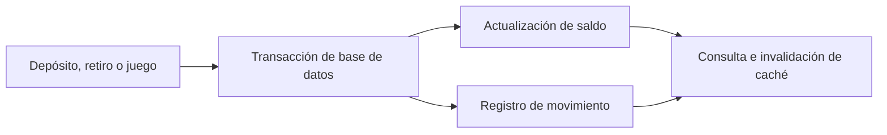

# 💰 Billetera y ledger

La billetera expone saldo, bono y totales; el historial permite seguir depósitos, retiros, apuestas y premios. El servidor es la autoridad del saldo. Las operaciones simuladas usan `metodo: "simulado"`.

Separar el bono del saldo: no deducir que todo total mostrado es apostable o retirable. Evitar acreditar premios de forma optimista.

Relaciona [[cerebro/juegos/Juegos|Juegos]], [[cerebro/economia/Pagos Stripe|Pagos Stripe]], [[cerebro/arquitectura/Datos|Datos]] y [[cerebro/arquitectura/Contratos y operaciones|Operaciones]].

Fuentes: [wallet.api.ts](../../frontend/src/features/wallet/wallet.api.ts), [transaction.service.js](../../backend/src/modules/transactions/transaction.service.js), módulos `wallet` y repositorios de juegos en backend.

## Atomicidad

El helper del ledger acredita o debita junto con el movimiento dentro de la transacción. Los montos persistidos usan Decimal; el débito condicional comprueba saldo y las operaciones por usuario bloquean la billetera. Fuente: [ledger.js](../../backend/src/shared/utils/ledger.js).

## Arquitectura objetivo

[[cerebro/backend/servicios/Economia|Servicio Economía]] · [[cerebro/frontend/microfrontends/Economia|Microfrontend Economía]] · [[cerebro/datos/entidades/Wallet]] · [[cerebro/datos/entidades/Movimiento]]
